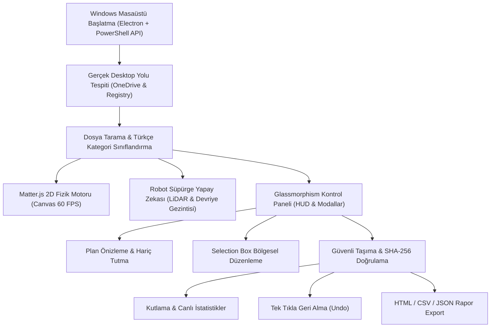

<div align="center">

# 🤖 Cleanfy — Akıllı Masaüstü Robot Süpürgesi & Fizik Tabanlı Düzenleyici

<p align="center">
  <strong>Windows 10 ve 11 için fizik simülasyonlu, LiDAR taramalı ve %100 güvenli masaüstü düzenleme robotu.</strong><br>
  <em>Masaüstünüz yaşayan bir oyun alanına dönüşsün: Matter.js çarpışma fiziği, Selection Box ile bölgesel dizilim, Türkçe sınıflandırma ve tek tıkla geri alma.</em>
</p>

<p align="center">
  <a href="LICENSE"></a>
  <a href="https://github.com/omerfys/Cleanfy/stargazers"></a>
  <a href="https://www.typescriptlang.org/"></a>
  <a href="https://react.dev/"></a>
  <a href="https://www.electronjs.org/"></a>
  <a href="https://brm.io/matter-js/"></a>
  <a href="https://tailwindcss.com/"></a>
  
  
</p>

<br>

> **Cleanfy**, Windows masaüstünü sıkıcı bir dosya listesinden çıkarıp yaşayan bir fizik ekosistemine dönüştüren açık kaynaklı bir masaüstü uygulamasıdır. Ekranda serbestçe dolaşan, engellerden kaçan ve döner fırçalarıyla tozu süpüren gerçekçi bir robot süpürge simülasyonu sunarken; arka planda masaüstündeki tüm dosyaları güvenli, geri alınabilir ve kural tabanlı bir hiyerarşiyle tertemiz klasörlere yerleştirir.

[Başlangıç](#-hızlı-başlangıç--kurulum) • [Özellikler](#-özellikler-features) • [Selection Box](#-selection-box-ile-bölgesel-özel-dizilim) • [Mimari](#-mimari--çalışma-prensibi) • [Güvenlik Garantisi](#-kesin-güvenlik--veri-bütünlüğü-garantisi) • [English Overview](#-english-overview)

---

</div>

## 📑 İçindekiler (Table of Contents)

- [🌟 Proje Vizyonu](#-proje-vizyonu)
- [✨ Özellikler (Features)](#-özellikler-features)
- [🎯 Selection Box ile Bölgesel Özel Dizilim](#-selection-box-ile-bölgesel-özel-dizilim)
- [📊 Mimari & Çalışma Prensibi](#-mimari--çalışma-prensibi)
- [📂 %100 Türkçe Klasör & Kategori Hiyerarşisi](#-100-türkçe-klasör--kategori-hiyerarşisi)
- [🛡️ Kesin Güvenlik & Veri Bütünlüğü Garantisi](#-kesin-güvenlik--veri-bütünlüğü-garantisi)
- [🚀 Hızlı Başlangıç & Kurulum](#-hızlı-başlangıç--kurulum)
- [🎛️ Glassmorphism Kontrol Paneli](#️-glassmorphism-kontrol-paneli)
- [⏪ Geri Alma (Undo) & Raporlama](#-geri-alma-undo--raporlama)
- [⚡ Sıfır Donma & Optimize Edilmiş Fizik Motoru](#-sıfır-donma--optimize-edilmiş-fizik-motoru)
- [❓ Sıkça Sorulan Sorular (FAQ)](#-sıkça-sorulan-sorular-faq)
- [🌍 English Overview](#-english-overview)
- [🔍 SEO Anahtar Kelimeler (SEO Index)](#-seo-anahtar-kelimeler-seo-index)
- [📜 Lisans & Yazar](#-lisans--yazar)

---

## 🌟 Proje Vizyonu

Klasik masaüstü temizleyiciler ve düzenleme betikleri genellikle sıkıcı, ruhsuz ve riskli araçlardır. Bir butona basarsınız ve dosyalarınızın nereye gittiğini tam olarak göremeden kaybolur.

**Cleanfy**, bu deneyimi baştan aşağı yeniden tasarlar:
1. **Görsel & Kinetik Deneyim:** Masaüstü simgeleriniz gerçek fiziksel nesneler haline gelir. Robot süpürge odanızı süpürür gibi masaüstünüzde devriye atar, LiDAR demetleriyle dosyaları tarar ve ön tamponuyla simgeleri yumuşakça iter.
2. **Kullanıcı Kontrolünde Doğal Dil Dizilimi:** `Selection Box` aracı sayesinde ekranın istediğiniz bir köşesini (örneğin sağ üst veya sol sütun) fareyle seçip *"buraya sadece oyunları koy"* veya *"buraya sadece klasörleri diz"* diyebilirsiniz.
3. **Sıfır Risk & Güven:** Dosyalar asla silinmez, üzerine yazılmaz; her adım SHA-256 özet doğrulamasıyla korunur ve tek tıkla eski haline geri döndürülebilir.

---

## ✨ Özellikler (Features)

- 🤖 **Gerçekçi 2D/2.5D Robot Süpürge Simülasyonu:**
  - Bağımsız dönen üst **LiDAR lazer kubbesi** ve mavi tarama demeti.
  - Ön optik ve ultrasonik mesafe algılama sensörleri.
  - Yaylı ve esnek **ön çarpışma tamponu (bumper)**.
  - Gövde altında sürekli dönen **çift yan fırça** ve dinamik zemin toz parçacıkları.
- ⚙️ **Matter.js 2D Sert Cisim Fiziği:**
  - Gerçek kütle, sürtünme ve esneklik katsayıları.
  - Robot dosyalara çarptığında simgeler gerçekçi biçimde kayar ve birbirini iter.
  - İkonlar dik açılarını korur (`angle = 0`), yazıları ve rozetleri her zaman okunaklı kalır.
- 🎯 **Selection Box & Bölgesel Düzenleme:**
  - Ekranın herhangi bir noktasında dikdörtgen alan seçebilme.
  - Doğal dil Türkçe prompt desteği veya tek tıkla hazır kategori çipleri.
  - Hedef bölgeye uymayan dosyaları otomatik olarak bölge dışına kaydırma ve sadece istenen dosyaları nizami ızgaraya dizme.
- 🪟 **Kompakt Glassmorphism Kontrol Menüsü:**
  - Sağ üst köşede minimalist, gizlenebilir ve akıcı yay (spring) animasyonlu kontrol paneli.
  - İlk açılışta masaüstünü kapatmayan zarif rozet görünümü.
- 📁 **Akıllı Türkçe Kategori Tanıma:**
  - 13 ana kategori ve onlarca alt klasör türü.
  - `.url` Steam / Epic / Riot oyun kısayollarını otomatik tespit eden oyun zekası.
- 🛡️ **Geri Alınabilir & SHA-256 Doğrulamalı İşlemler:**
  - Yapılan tüm taşımalar tek tıkla geri alınabilir (`UndoSession`).
  - Çıktılar **HTML**, **JSON** ve Excel uyumlu **CSV (UTF-8 BOM)** olarak dışa aktarılabilir.

---

## 🎯 Selection Box ile Bölgesel Özel Dizilim

Cleanfy, tüm masaüstünü toptan temizlemek yerine belirli bölgeleri özelleştirmenize olanak tanır:

```text
┌─────────────────────────────────────────────────────────────────┐
│                       MASAÜSTÜ EKRANI                           │
│                                                                 │
│  [Belgeler]       [Kodlar]                                      │
│                                           ┌──────────────────┐  │
│                                           │  SELECTION BOX   │  │
│  [Fotoğraflar]                            │  "Sadece Oyunlar"│  │
│                                           │  🎮 Cyberpunk    │  │
│             🤖 Robot Süpürge              │  🎮 Valorant     │  │
│                (Devriye)                  │  🎮 Stardew      │  │
│                                           └──────────────────┘  │
└─────────────────────────────────────────────────────────────────┘
```

1. Sağ üst menüden **`🎯 Alan Seç & Özel Diz`** butonuna tıklayın.
2. Farenizle masaüstünün istediğiniz köşesinde bir dikdörtgen çizin.
3. Açılan Glassmorphism penceresinde hazır çiplerden (`🎮 Sadece Oyunlar`, `📁 Sadece Klasörler`, `📦 Sadece Arşivler`, `☕ Jar & Kodlar`, vb.) birini seçin ya da doğal dille isteğinizi yazın.
4. **Uygula** dediğinizde robot süpürge o bölgeye yönelir; eşleşen dosyalar yumuşak bir kayma animasyonuyla alana yerleşirken, diğer dosyalar otomatik olarak bölge dışına taşınır.

---

## 📊 Mimari & Çalışma Prensibi



---

## 📂 %100 Türkçe Klasör & Kategori Hiyerarşisi

Cleanfy, dosyaları rastgele klasörlere tıkmak yerine profesyonel bir arşiv düzeni oluşturur:

```text
Masaüstü/
├── 📁 Fotoğraflar ve Görseller/        (jpg, jpeg, png, webp, gif, bmp, tiff, ico, heic, raw)
├── 📁 Videolar/                         (mp4, mkv, mov, avi, webm, wmv, flv, m4v)
├── 📁 Müzikler ve Sesler/               (mp3, wav, flac, aac, ogg, m4a, wma)
├── 📁 Belgeler/
│   ├── 📁 PDF Belgeleri/               (pdf)
│   ├── 📁 Word Belgeleri/              (doc, docx, odt)
│   ├── 📁 Tablolar ve Hesaplamalar/    (xls, xlsx, csv, ods, tsv)
│   ├── 📁 Metin Dosyaları/             (txt, md, rtf, log)
│   └── 📁 Diğer Belgeler/              (ppt, pptx, odp, epub, mobi)
├── 📁 Yazılımlar ve Kurulum Dosyaları/ (exe, msi, msix, bat, cmd, ps1, iso, img)
├── 📁 Sıkıştırılmış Dosyalar/           (zip, rar, 7z, tar, gz, bz2, xz)
├── 📁 Yazılım ve Kod Projeleri/
│   ├── 📁 Python Projeleri/            (py, pyw, ipynb)
│   ├── 📁 Web Projeleri/               (html, css, js, ts, jsx, tsx, vue, svelte, json)
│   ├── 📁 Java Projeleri/              (java, jar, class)
│   └── 📁 Diğer Kod Dosyaları/         (c, cpp, cs, rs, go, php, rb, sql, sh, yaml)
├── 📁 Tasarım ve Çizim Dosyaları/      (psd, ai, blend, svg, xd, fig, sketch, dwg)
├── 📁 Oyunlar ve Oyun Kısayolları/     (Steam, Epic, Riot, Roblox, Minecraft ve URL kısayolları)
├── 📁 İnternet Kısayolları/            (url, webloc)
├── 📁 Yedekleme Dosyaları/             (bak, old, backup, dump)
├── 📁 Geçici ve İncelenecek Dosyalar/  (tmp, temp, uzantısız dosyalar)
└── 📁 Diğer Dosyalar/                  (sınıflandırılamayan diğer uzantılar)
```

> [!NOTE]
> Sıfır dosyası olan kategoriler için asla boş klasör açılmaz. Masaüstünüzde önceden var olan kişisel klasörlerinize asla izinsiz dokunulmaz.

---

## 🛡️ Kesin Güvenlik & Veri Bütünlüğü Garantisi

1. **Silme API'si Bulunmaz:** Kod tabanında dosya silme (`fs.unlink`, `rmdir`, `trash`) veya Geri Dönüşüm Kutusu'na atma işlevi kesinlikle yer almaz.
2. **SHA-256 İçerik Doğrulaması:** Dosya taşınmadan önce ve taşındıktan sonra sağlama toplamı (hash) hesaplanır; 1 bayt bile uyuşmazsa işlem derhal durdurulur.
3. **Üzerine Yazmama Koruması:** Hedef klasörde aynı isimde dosya varsa üzerine yazılmaz; otomatik olarak `dosya (1).ext`, `dosya (2).ext` şeklinde güvenle adlandırılır.
4. **Masaüstü Dizin Sınırı (No Path Traversal):** Taşıma işlemleri kesinlikle kullanıcının Masaüstü diziniyle sınırlandırılmıştır.

---

## 🚀 Hızlı Başlangıç & Kurulum

### Gereksinimler
- **İşletim Sistemi:** Windows 10 veya Windows 11 (64-bit)
- **Node.js:** v18+ (Önerilen: Node.js 20 veya 22 LTS)

### 1. Depoyu Klonlayın
```bash
git clone https://github.com/omerfys/Cleanfy.git
cd Cleanfy
```

### 2. Bağımlılıkları Yükleyin
```bash
npm install
```

### 3. Tek Tıkla Başlatın (Windows)
Klasördeki `start.bat` dosyasına çift tıklayarak uygulamayı derlenmiş `.exe` sürümüyle anında çalıştırabilirsiniz:
```cmd
start.bat
```

### 4. Geliştirici Modunda Çalıştırma (Canlı Yenileme)
```bash
npm start
```

### 5. Windows EXE Olarak Paketleme
```bash
npm run package
```
Çıktı dosyası `release/win-unpacked/Cleanfy Robot Süpürge.exe` dizininde oluşturulur.

---

## 🎛️ Glassmorphism Kontrol Paneli

Sağ üst köşedeki kompakt panel üzerinden tüm operasyonları yönetebilirsiniz:

| Buton / Eleman | İşlev |
| :--- | :--- |
| **🔍 Tara** | Masaüstünü anlık olarak tarar, simgeleri fizik dünyasına aktarır. |
| **✨ Başlat** | Güvenli temizlik sürecini başlatır; robot her dosyaya giderek taşır. |
| **⏸️ Duraklat / Devam** | Temizlik sürecini istediğiniz saniyede duraklatıp devam ettirir. |
| **⏹️ Durdur** | Temizliği durdurur ve robotu serbest dolaşma moduna geçirir. |
| **🎯 Alan Seç & Özel Diz** | Ekranda kutu çizerek belirli dosya tiplerini o alana toplar. |
| **📋 Plan** | Dosyaları tek tek inceleyebileceğiniz ve hariç tutabileceğiniz önizleme modalı. |
| **📄 Rapor** | Yapılan taşımaların geçmişini ve dosya yollarını gösteren detaylı rapor. |
| **⏪ Geri Al** | Son temizlik oturumunda taşınan tüm dosyaları anında eski yerine döndürür. |

---

## ⏪ Geri Alma (Undo) & Raporlama

- **Oturum Bazlı Geri Alma:** Temizlik işlemi tamamlandığında oturum kaydı hafızaya alınır. `Geri Al` butonuna bastığınızda taşınan tüm dosyalar güvenle orijinal masaüstü konumlarına geri çekilir.
- **Dışa Aktarma Formatları:**
  - 🌐 **HTML Raporu:** Renkli, filtrelenebilir ve yazdırmaya hazır görsel rapor.
  - 📊 **CSV Raporu:** Microsoft Excel ile tam uyumlu Türkçe karakter destekli UTF-8 BOM CSV çıktısı.
  - 📦 **JSON Raporu:** Otomasyonlar ve log arşivleri için standart JSON verisi.

---

## ⚡ Sıfır Donma & Optimize Edilmiş Fizik Motoru

- **60 FPS Hardware-Accelerated Canvas:** HTML5 Canvas 2D üzerinde GPU hızlandırmalı pürüzsüz çizim döngüsü.
- **Fail-Safe Render Döngüsü:** Çizim fonksiyonu `try/catch/finally` koruması altındadır; beklenmeyen anlık istisnalar render akışını asla durdurmaz.
- **Akıllı Çarpışma Filtreleme:** Dosyalar zemin sürtünmesiyle dengelenir, gereksiz takılmaları önleyen akıllı robot rota algoritması devrededir.

---

## ❓ Sıkça Sorulan Sorular (FAQ)

<details>
<summary><strong>1. Cleanfy dosyalarımı silebilir veya kaybedebilir mi?</strong></summary>
Kesinlikle hayır. Cleanfy'ın kaynak kodunda hiçbir dosya silme komutu bulunmaz. Tüm işlemler SHA-256 sağlamasıyla kontrol edilen güvenli taşıma işlemidir ve tek tıkla geri alınabilir.
</details>

<details>
<summary><strong>2. Masaüstündeki mevcut klasörlerime ne olur?</strong></summary>
Önceden oluşturduğunuz kullanıcı klasörlerine kesinlikle dokunulmaz. Cleanfy yalnızca sahipsiz ve dağınık dosya/kısayolları düzenler.
</details>

<details>
<summary><strong>3. OneDrive masaüstüm varsa çalışır mı?</strong></summary>
Evet. Cleanfy, Windows Kayıt Defteri (Registry) ve özel PowerShell tespit mekanizmasıyla OneDrive masaüstü yönlendirmelerini otomatik olarak tanır.
</details>

<details>
<summary><strong>4. Selection Box ile seçtiğim alanı nasıl sıfırlarım?</strong></summary>
Sağ üst menüde beliren "Sıfırla" butonuna tıklayarak özel alana sabitlenen dosyaları anında serbest bırakabilirsiniz.
</details>

---

## 🌍 English Overview

**Cleanfy** is an intelligent, physics-driven desktop organization tool and robot vacuum simulator designed for Windows 10 & 11. Built with Electron, React 19, TypeScript, and Matter.js, it turns your cluttered desktop into an interactive physics sandbox while categorizing and moving files into clean, organized Turkish directories with zero risk of data loss.

### Key Highlights:
- **Kinetic Physics Engine:** Files act as physical bodies that react to the robot's bumper, brushes, and momentum.
- **Selection Box Regional Organizer:** Drag a selection rectangle anywhere on the screen and instruct the robot to gather specific file types (games, folders, code, archives) into that precise area.
- **Strict Zero-Data-Loss Safety:** No deletion APIs, SHA-256 verification before and after moving, collision-safe renaming (`file (1).ext`), and single-click Undo.
- **Compact Glassmorphism HUD:** Sleek top-right controller that stays out of your way until summoned.

---

## 🔍 SEO Anahtar Kelimeler (SEO Index)

`Cleanfy` • `Desktop Organizer` • `Masaüstü Robot Süpürge` • `Windows Desktop Cleaner` • `Matter.js Physics` • `Electron Desktop App` • `React 19` • `TypeScript` • `Canvas 2D Simulation` • `Interactive Vacuum Robot` • `Selection Box Organizer` • `Otomatik Dosya Düzenleyici` • `Güvenli Masaüstü Temizleyici` • `Omerfy` • `Creative Coding` • `Zero Data Loss` • `Undo Desktop Organization`

---

## 📜 Lisans & Yazar

Bu proje [MIT Lisansı](LICENSE) altında açık kaynak olarak sunulmuştur.

Geliştirici: **[@omerfys](https://github.com/omerfys)**  
GitHub Deposu: [https://github.com/omerfys/Cleanfy](https://github.com/omerfys/Cleanfy)

⭐ **Projeyi beğendiyseniz GitHub üzerinden yıldız vermeyi unutmayın!**
